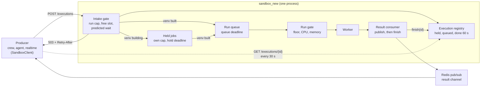
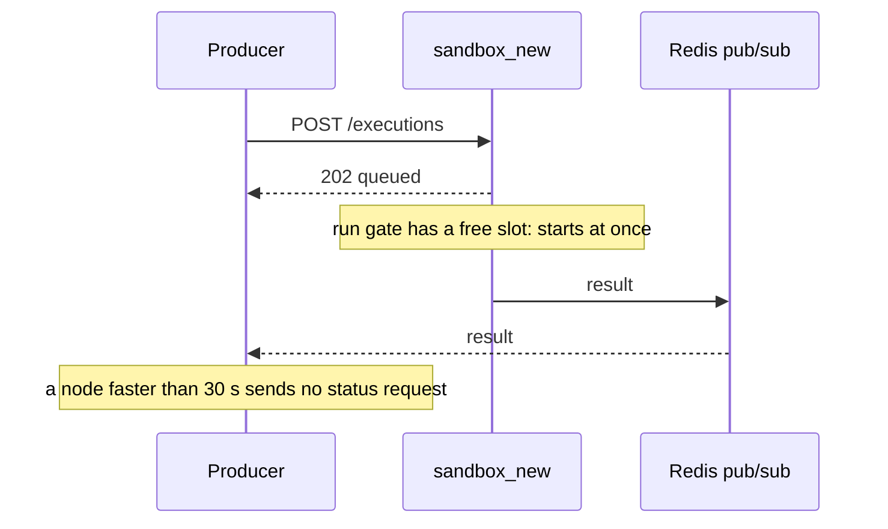
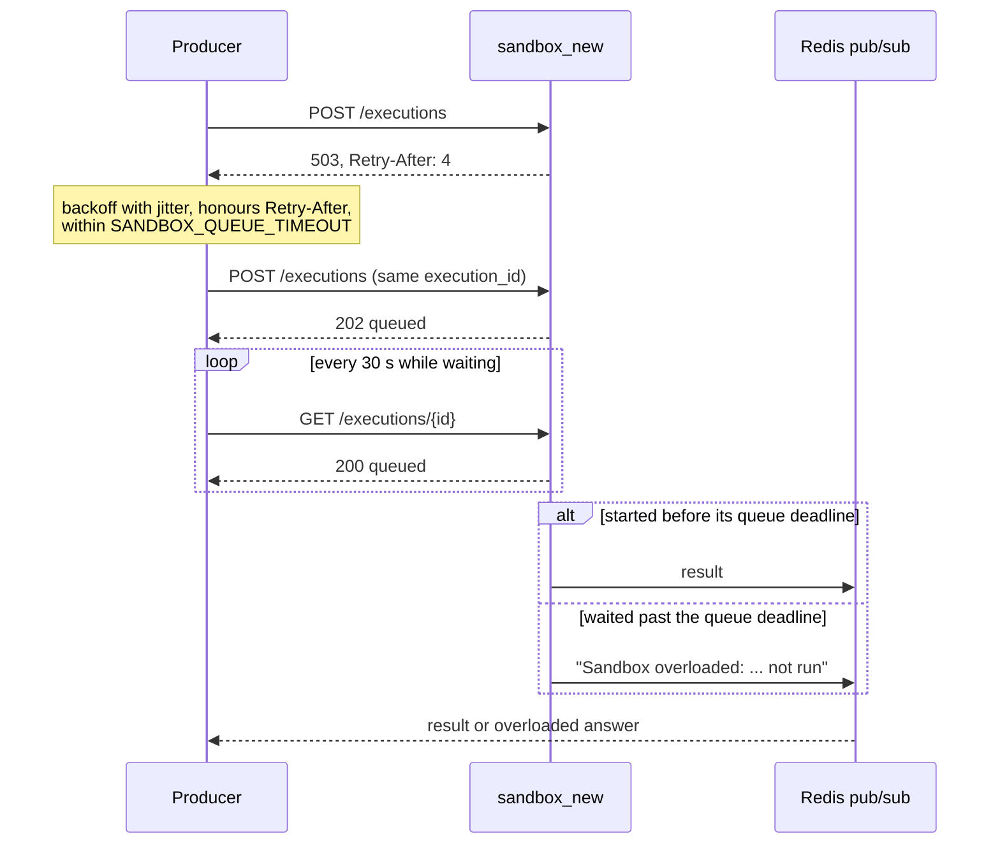
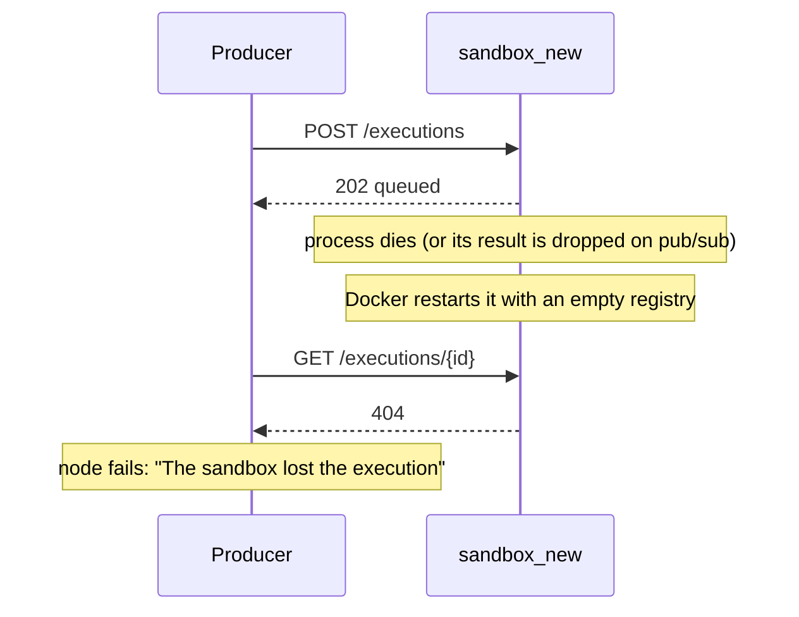

# Sandbox admission control

Every Python execution a producer hands to `sandbox_new` ends in one of three ways: a result, an explicit "overloaded" answer, or the sandbox no longer knowing it (404). Producers detect the third case within about 30–90 s. No session waits forever for a result that will never come.

This folder records how that works and why it was built this way. The decisions are in [`adr/`](adr/), one per file; this page shows how they fit together.

## How to read these records

- Start with this page for the whole picture, then open the ADR for the part you are changing.
- Each ADR follows [MADR](https://adr.github.io/madr/). Read **Context and Problem Statement** and **Decision Outcome** to learn what was decided. Read **Considered Options** and **Consequences** before you argue for a different approach: most alternatives were weighed and rejected for a stated reason.
- An accepted ADR is not edited to change its decision. A new ADR supersedes it, and the old one's status says "Superseded by NNNN". Facts may still be added to **Validation**, for example benchmark results.
- Numbers marked *estimate* were not measured when the decision was made. Treat them as assumptions to check.

## Decisions

| ADR | Decision |
| --- | --- |
| [0001](adr/0001-http-intake-and-pubsub-results.md) | Keep HTTP intake and pub/sub results; no Redis task queue |
| [0002](adr/0002-execution-registry-and-status-endpoint.md) | An in-memory execution registry and a status endpoint |
| [0003](adr/0003-intake-admission-by-predicted-queue-wait.md) | Admit work by predicted queue wait, with a run cap |
| [0004](adr/0004-run-gate-on-measured-cpu-and-memory.md) | Start executions by measured CPU and memory, not a fixed count |
| [0005](adr/0005-queue-deadlines-owned-by-the-sandbox.md) | The sandbox owns queue deadlines; stale jobs are not run |
| [0006](adr/0006-held-jobs-cap-and-hold-deadline.md) | Jobs waiting for a venv build have their own cap and deadline |
| [0007](adr/0007-producer-clients-per-service.md) | Each producer owns its sandbox client |
| [0008](adr/0008-every-path-ends-in-a-result.md) | Every path ends in a result; a dead runner restarts the process |
| [0009](adr/0009-benchmark-checkpoints.md) | BENCH checkpoints and a gate-state sample |

## The request path

- **Intake** ([0003](adr/0003-intake-admission-by-predicted-queue-wait.md), [0006](adr/0006-held-jobs-cap-and-hold-deadline.md)) decides whether a job may wait in line at all. A refused job gets 503 with `Retry-After`, and the producer retries with backoff.
- **The run gate** ([0004](adr/0004-run-gate-on-measured-cpu-and-memory.md)) decides when a queued job may start.
- **The registry** ([0002](adr/0002-execution-registry-and-status-endpoint.md)) knows every accepted job until 60 s after its result is published. A producer that is still waiting when the registry no longer knows its job treats the job as lost.

## Normal load

## Heavy load

Under overload, users first see slower runs, then a clear "overloaded" error. Nothing waits without a limit.

## Crash, restart or lost result

## Settings

All are set in `src/env.yaml`, which generates `src/.env.example`.

| Setting | Default | Read by | Meaning |
| --- | --- | --- | --- |
| `SANDBOX_QUEUE_TIMEOUT` | 120s | sandbox_new, crew, agent, realtime | How long a job may wait in the run queue; the intake prediction limit; the producers' 503 retry budget |
| `SANDBOX_MAX_ACCEPTED_EXECUTIONS` | 300 | sandbox_new | Queued or running executions accepted at once (set from the benchmark) |
| `SANDBOX_MAX_HELD_EXECUTIONS` | 100 | sandbox_new | Executions waiting for a venv build |
| `SANDBOX_HOLD_TIMEOUT` | 30m | sandbox_new | How long an execution may wait for its venv build |
| `SANDBOX_MIN_CONCURRENT_EXECUTIONS` | 0 | sandbox_new | Run floor; 0 means the CPUs the container may use |
| `SANDBOX_MAX_CONCURRENT_EXECUTIONS` | 256 | sandbox_new | Hard cap on running executions |
| `SANDBOX_CPU_ADMIT_THRESHOLD` | 85 | sandbox_new | Host CPU % above which nothing starts beyond the floor |
| `SANDBOX_MEMORY_ADMIT_THRESHOLD` | 80 | sandbox_new | Container memory % above which nothing starts beyond the floor |
| `CREW_CODE_RESULT_TIMEOUT`, `AGENT_CODE_RESULT_TIMEOUT`, `REALTIME_CODE_RESULT_TIMEOUT` | 35m | crew, agent, realtime | Backstop: the longest a producer waits for a result |

## Invariants

- **Exactly one sandbox process.** The run queue and the execution registry live in one process's memory. `entrypoint.sh` runs uvicorn with `--workers 1`; never add workers or replicas without first replacing this state (see [0001](adr/0001-http-intake-and-pubsub-results.md)).
- **No process-local value crosses the seam.** Messages in `common/contracts.py` must keep their meaning if the manager and the worker are split into separate processes. The queue time travels as `queued_at`, a wall-clock timestamp, never as a monotonic reading ([0005](adr/0005-queue-deadlines-owned-by-the-sandbox.md)).
- **Secrets stay in RAM.** Job payloads carry plaintext secrets and storage credentials. They are never written to Redis or disk, and logs carry ids and exception types only.

## Layers

sandbox_new follows a hexagonal layout: decisions live in `application`, the outside world in `infrastructure`, and the composition root in `common/bootstrap` wires them. These rules are enforced by import-linter contracts in `src/sandbox_new/pyproject.toml`, checked in CI:

- `manager.infrastructure` imports from `manager.application` only its `ports`.
- `worker.infrastructure` imports from `worker.application` only its `ports` and `context`.
- `common` imports no `infrastructure` module, except `common.bootstrap`, the composition root.
- `manager` and `worker` never import each other; only `common.bootstrap` connects them.

| Concern | Where it lives |
| --- | --- |
| Admission policy (intake gate, run gate) | `manager/application/intake.py`, `worker/application/resource_gate.py` |
| Reading CPU and memory | `worker/infrastructure/admission/host_metrics.py`, behind the `AbstractHostMetrics` port |
| Loops that push the application (result consumer, held-job releaser) | `manager/presentation/` |
| Gate-state sampling for the benchmark | `common/observability/gate_sampler.py`, typed on protocols, not on either side's classes |
| Wiring and runner supervision | `common/bootstrap/lifespan.py` |
